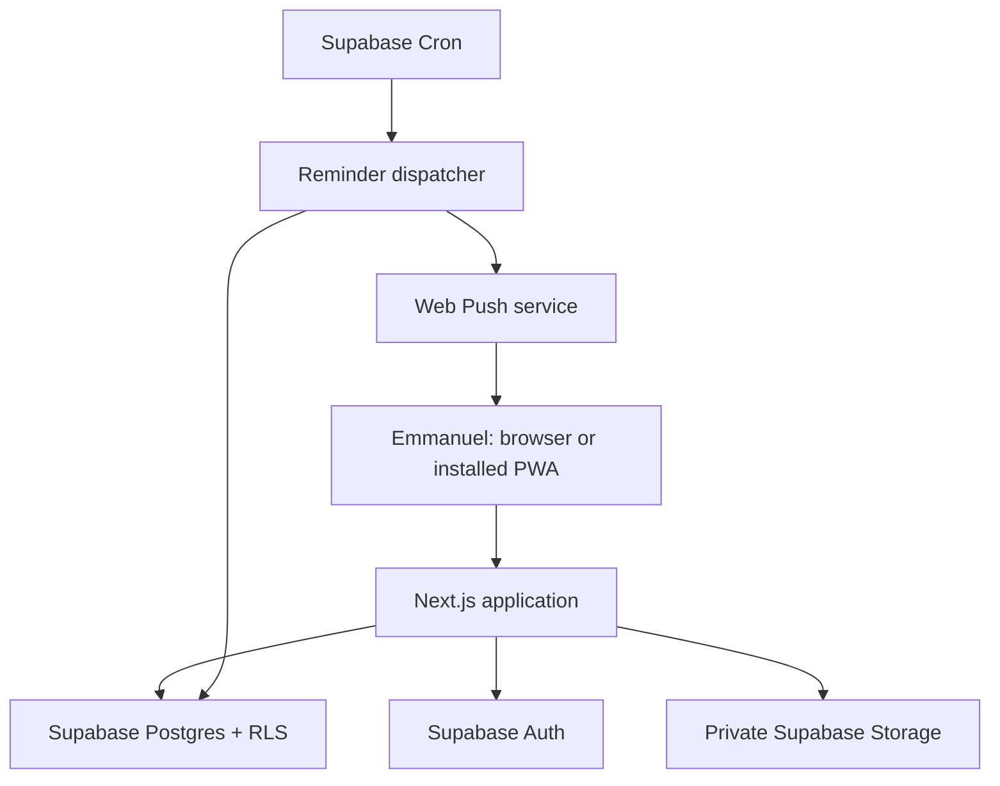

# GradMap architecture

## 1. Architectural intent

GradMap is an online-first, single-owner application with future-safe user isolation. It favors a small number of managed components, database-enforced authorization and clear recovery over architectural novelty.

The browser is untrusted. Next.js and Supabase Auth establish identity; Postgres RLS and Storage policies enforce authorization. Any elevated worker is treated as a narrow privileged boundary.

## 2. System context



No separate Express/FastAPI service is required. Supabase supplies Auth, Postgres, Storage and scheduling; Next.js supplies the application server and privileged route boundaries.

## 3. Technology decisions

| Concern | Decision | Reason |
| --- | --- | --- |
| Frontend/server | Next.js App Router | Strong routing, server/client composition and secure server boundaries |
| UI | Tailwind CSS + shadcn/ui | Accessible primitives with full ownership of presentation |
| Package manager | pnpm | Fast, deterministic installs with committed lockfile |
| Authentication | Supabase email/password + TOTP MFA | Integrated JWT claims and RLS-compatible assurance levels |
| Database | Supabase Postgres | Relational application data and database-enforced ownership |
| Files | One private Supabase Storage bucket | Fine-grained policies and versioned application documents |
| Scheduling | Supabase Cron + protected dispatcher/Edge Function | Reliable reminder evaluation while the PWA is closed |
| Push | Standards-based Web Push with VAPID | Installed web-app notifications without a native app |
| Validation | Zod at every external boundary | Shared runtime validation and typed errors |
| Testing | Vitest + Playwright + SQL/RLS tests | Covers domain logic, UI flows and authorization failures |

The implementing agent must confirm current stable package/API guidance and pin exact resolved versions. The baseline documentation used while writing this specification was Next.js 16-era App Router and current Supabase SSR guidance.

## 4. Application boundaries

### Public routes

- `/login`
- `/forgot-password`
- `/auth/callback`
- `/reset-password` with valid recovery session
- `/privacy` if a policy page is provided
- Static PWA assets: manifest, icons and service worker

Public routes must reveal no application counts, document names, user identity or private navigation metadata.

### Authenticated pre-MFA routes

- `/mfa/setup`
- `/mfa/challenge`
- `/logout`
- Minimal account recovery/help UI

These routes operate at AAL1 and cannot query the protected application tables.

### AAL2 application routes

- `/dashboard`
- `/programs`
- `/scholarships`
- `/applications`
- `/calendar`
- `/tasks`
- `/documents`
- `/essays`
- `/recommenders`
- `/contacts`
- `/notifications`
- `/settings`

All data and file operations require authenticated ownership. Sensitive bulk export, document download and destructive settings require current AAL2 validation at the server boundary even when RLS also enforces it.

## 5. Next.js structure

Suggested structure, adapted to the current stable framework conventions:

```text
src/
  app/
    (public)/
    (auth)/
    (app)/
    api/
  components/
    ui/
    shell/
    domain/
    charts/
  features/
    applications/
    programs/
    scholarships/
    documents/
    reminders/
  lib/
    supabase/
      client.ts
      server.ts
      proxy.ts
      admin.ts
    auth/
    validation/
    security/
    dates/
  types/
supabase/
  migrations/
  functions/
  tests/
public/
  icons/
  sw.js
```

Principles:

- Server Components render initial private data wherever practical.
- Client Components own interactive controls, local form state, browser push APIs and install prompts.
- Supabase clients are instantiated per request. User-specific state is never module-global.
- Server-only modules use explicit server-only boundaries.
- Application services return typed results and domain errors, not raw provider errors.
- Authenticated routes force dynamic/private rendering and do not use ISR.

## 6. Authentication flow

1. User submits email/password to Supabase Auth.
2. Auth session is stored using the current `@supabase/ssr` cookie pattern.
3. Next.js Proxy refreshes/verifies token state using the current official method.
4. Server checks verified claims.
5. If no verified TOTP factor exists, route to MFA enrollment.
6. If factor exists but current session is AAL1, route to MFA challenge.
7. Only AAL2 sessions enter the application shell.
8. Postgres restrictive MFA policies independently deny protected rows to AAL1.

Do not authorize server operations from `getSession()` alone. Production registration is disabled after the owner's account is provisioned.

## 7. Database access

### Normal user operations

- Use the user's JWT with Supabase server/client libraries.
- RLS is the final authorization layer.
- Every user-owned record contains `user_id` and ownership-aware relationships.
- Client-side filtering is for UX only, never authorization.

### Privileged operations

Only narrowly defined scheduled notification dispatch, protected administrative setup and recovery operations may use the server secret key. These modules:

- Are server-only.
- Validate a cron/admin secret before running.
- Select only due/required records.
- Never accept arbitrary table/column/filter input.
- Log operation outcome without confidential payloads.
- Are tested for unauthorized invocation.

## 8. Private file flow

### Upload

1. Validate AAL2, ownership, file size, MIME type, extension and filename.
2. Create a `document_versions` identifier and deterministic owner-scoped path.
3. Upload to private bucket `application-files` at:
   `{user_id}/{document_id}/{document_version_id}/{safe_filename}`.
4. Compute/store SHA-256 and metadata.
5. Mark the version current transactionally; preserve prior versions.
6. If database persistence fails, remove the uploaded object through the Storage API.
7. If upload fails, do not create a ready version record.

Standard uploads are suitable for files up to 6 MB; use a current resumable/TUS path above that threshold. The product cap is 20 MB per file unless Emmanuel deliberately changes it.

### Read/preview

- Prefer authenticated download returning a Blob URL for the active session.
- If a signed URL is necessary, keep expiry very short (approximately 60 seconds) and never persist it.
- Do not include document names/content in analytics logs.
- Set private/no-store response behavior.

### Delete

- Require AAL2 and explicit confirmation.
- Refuse deletion when the version is referenced by a submitted requirement unless the user first replaces/unlinks it.
- Delete using Storage API, then update metadata/audit state.
- Surface permanent-deletion semantics clearly.

## 9. Reminder and notification architecture

### User-facing layers

1. **In-app notifications:** always available and stored in `notifications`.
2. **Web Push:** opt-in per installed browser/device.
3. **Email:** optional later; not a prerequisite for MVP completion.

### Scheduling model

- Deadlines and tasks store due times in UTC.
- Reminders store an offset or explicit schedule and materialize the next due occurrence.
- A Cron job runs every five minutes.
- The dispatcher atomically claims due work so concurrent/retried runs cannot duplicate delivery.
- For each occurrence, it creates one in-app notification and attempts delivery to enabled push subscriptions.
- A unique idempotency key covers `(reminder_id, scheduled_for, channel, subscription_id where relevant)`.
- Transient failures receive bounded exponential retry; permanent invalid-subscription responses disable that subscription.
- Delivery attempts contain status/error classification, not sensitive document or essay content.

### Push privacy

- Default title: `GradMap reminder`.
- Default body uses a low-sensitivity summary, such as `You have an application item due soon.`
- A user preference may permit more descriptive text.
- Payload route is an allowlisted internal relative path, never an arbitrary URL.
- Service-worker click handling focuses an existing window or opens the internal route.

### Cron security

- Store scheduler invocation secrets in Supabase Vault/server secrets.
- Verify the secret in the dispatcher.
- Do not put elevated Supabase credentials in the cron request body.
- Keep dispatcher endpoints non-discoverable in navigation but do not rely on obscurity.

## 10. PWA architecture

Installability requirements:

- `app/manifest.ts` or current framework equivalent.
- App name, short name, description, start URL, standalone display, theme/background colors.
- 192×192 and 512×512 icons plus a maskable icon.
- HTTPS in production.
- Service worker registration and update strategy.
- Custom install guidance for Android/desktop and iOS Add to Home Screen.

The service worker:

- Handles install lifecycle and push/notification-click events.
- May cache versioned static public assets and an offline informational page.
- Must never cache authenticated navigation responses, `/api/**`, Supabase endpoints, auth callbacks, Storage URLs, document blobs or application JSON.
- On offline navigation, shows a neutral page explaining that GradMap requires internet; it must not display stale private information.

There is no IndexedDB application database, mutation queue, background sync or conflict resolution.

## 11. Search, filtering and views

- Global command palette searches already-authorized records returned for the owner.
- Large lists use server-side filtering and cursor/keyset pagination when necessary.
- Filters are represented in URL search parameters where shareable/bookmarkable within the user's session.
- Board, table and calendar views use the same canonical records; no duplicated status stores.

## 12. Data export and recovery

- Export JSON for complete structured owner data and CSV for useful tabular entities.
- Exports require AAL2 and an explicit action.
- Exports never contain auth tokens, secrets, push encryption keys or temporary signed URLs.
- Optional file archive export must stream private files server-side and be separately confirmed.
- Maintain migration-based schema recovery and documented Supabase backup expectations.
- Emmanuel should periodically download an export during application season.

## 13. Observability

Log:

- Request/worker correlation ID.
- Route/operation category.
- Success/failure classification.
- Entity type and opaque entity ID where useful.
- Notification counts and delivery provider status categories.

Never log:

- JWTs, cookies or passwords.
- Supabase secret keys or VAPID private key.
- Push subscription auth keys/endpoints in plain operational logs.
- Essay content, document URLs/names, recommender private notes or application form answers.

Error monitoring may be added after redaction is verified. User-facing errors are actionable and non-sensitive.

## 14. Deployment environments

- `local`: Supabase CLI and local Next.js.
- `preview`: isolated Supabase project or carefully isolated test tenant; never connect arbitrary preview deployments to production data.
- `production`: protected owner account, registration disabled, exact redirect URLs, HTTPS and production secrets.

Run migrations through CI or a documented controlled command. Do not use production as the first migration test.

## 15. Official implementation references

- Next.js PWA guide: https://nextjs.org/docs/app/guides/progressive-web-apps
- Next.js Content Security Policy: https://nextjs.org/docs/app/guides/content-security-policy
- Supabase SSR client setup: https://supabase.com/docs/guides/auth/server-side/creating-a-client
- Supabase RLS: https://supabase.com/docs/guides/database/postgres/row-level-security
- Supabase MFA: https://supabase.com/docs/guides/auth/auth-mfa
- Supabase Storage access control: https://supabase.com/docs/guides/storage/security/access-control
- Supabase private buckets: https://supabase.com/docs/guides/storage/buckets/fundamentals
- Supabase scheduled Edge Functions: https://supabase.com/docs/guides/functions/schedule-functions
- Supabase production checklist: https://supabase.com/docs/guides/deployment/going-into-prod

The agent must re-check these current official sources during implementation because framework and platform APIs change.
