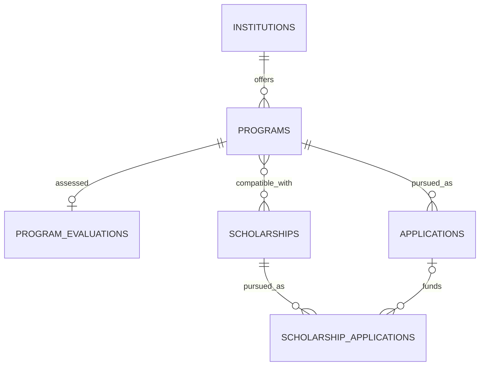
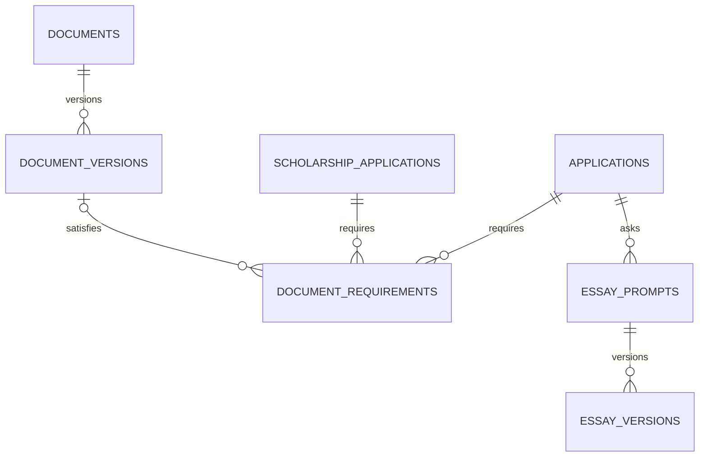
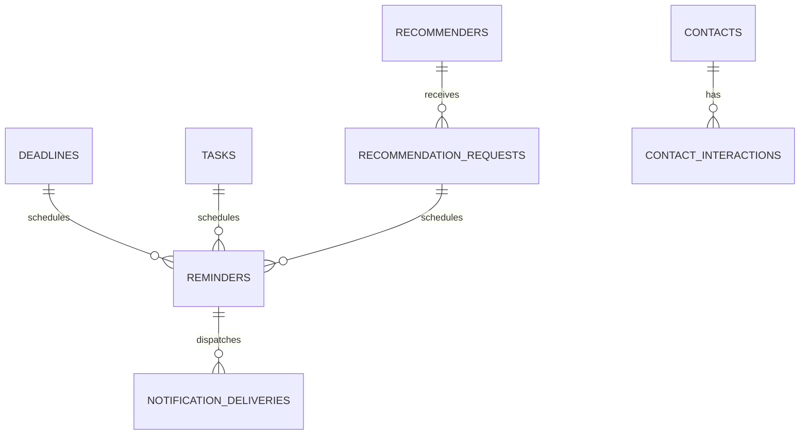

# GradMap data model

This document defines the logical Postgres model. The implementing agent must translate it into reviewed Supabase migrations, generated TypeScript types and RLS tests.

## 1. Modeling principles

1. **Ownership is explicit.** Every user-owned table contains `user_id uuid not null`.
2. **Authorization is enforced in Postgres.** RLS is enabled on every exposed table.
3. **MFA is enforced in Postgres.** Protected tables add a restrictive `aal2` policy.
4. **Cross-user references are impossible.** Child relationships include ownership-aware composite foreign keys where practical.
5. **Workflow values remain adaptable.** Use `text` plus check constraints instead of Postgres enums for changing statuses.
6. **Time is unambiguous.** Instants use `timestamptz`; date-only values use `date`; user timezone lives in profile/preferences.
7. **Money is exact.** Use `numeric(12,2)` plus ISO currency code; never float.
8. **Files live in Storage.** Database rows contain metadata and private object paths, never file bytes or permanent public URLs.
9. **Versions are immutable.** Documents and essays preserve history; “current” is an explicit pointer/flag.
10. **Deletion behavior is intentional.** Archive planning records when recovery matters; delete Storage objects through the Storage API.

## 2. Naming and common columns

- Lowercase snake_case only.
- Primary key: `id uuid primary key default gen_random_uuid()` for compatibility. Data volume is low; consistent UUID ownership is more important than index-locality optimization. A currently supported time-ordered UUID may be adopted consistently if verified before the first migration.
- Common user-owned columns:

```sql
id uuid primary key default gen_random_uuid(),
user_id uuid not null references auth.users(id) on delete cascade,
created_at timestamptz not null default now(),
updated_at timestamptz not null default now(),
archived_at timestamptz null
```

- Add `unique (id, user_id)` on parent tables referenced by ownership-aware composite foreign keys.
- Use a shared trigger for `updated_at` only if it is implemented safely with fixed search path and reviewed privileges; otherwise set it in application mutations.
- Every foreign-key column is indexed. Postgres does not add those indexes automatically.
- Text values that are conceptually bounded use check constraints (e.g. length, accepted status set).

## 3. Domain relationship overview

### Opportunities and applications



### Application materials



### Planning and communication



## 4. Identity and preferences

### `profiles`

One row per authenticated user.

| Column | Type | Rules/purpose |
| --- | --- | --- |
| `id` | uuid | PK and FK to `auth.users(id)` on delete cascade; also owner ID |
| `full_name` | text | Required, 1–120 chars |
| `timezone` | text | Required; default `Africa/Accra`; validate IANA value in app |
| `target_intake_year` | smallint | Default 2027; sensible check range |
| `expected_graduation_date` | date | Nullable until exact day is verified |
| `graduation_month_label` | text | Nullable display value such as `May 2027` without inventing a day |
| `theme` | text | `light`, `dark`, `system` |
| `onboarding_completed_at` | timestamptz | Nullable |
| `created_at` | timestamptz | Required |
| `updated_at` | timestamptz | Required |

RLS: owner select/update. Permit only the minimum AAL1 access needed for MFA bootstrap; all application data remains AAL2.

### `notification_preferences`

One row per user.

| Column | Type | Rules/purpose |
| --- | --- | --- |
| `user_id` | uuid | PK/FK to profile/auth user |
| `in_app_enabled` | boolean | Default true |
| `push_enabled` | boolean | Default false until explicit permission/subscription |
| `email_enabled` | boolean | Default false; optional future channel |
| `privacy_level` | text | `minimal`, `descriptive`; default minimal |
| `quiet_hours_start` | time | Nullable local time |
| `quiet_hours_end` | time | Nullable local time |
| `daily_digest_time` | time | Nullable/disabled by default |
| `default_offsets_minutes` | integer[] | Default equivalent of 7d, 3d, 1d; validate positive bounded values |
| `created_at`, `updated_at` | timestamptz | Required |

Quiet hours affect push delivery, not the visible due time or in-app record.

## 5. Institutions, programs and evaluations

### `institutions`

| Column | Type | Rules/purpose |
| --- | --- | --- |
| Common ownership columns | - | Includes archive support |
| `name` | text | Required, 1–200 chars |
| `country_code` | text | Nullable ISO 3166-1 alpha-2 |
| `country_name` | text | Required when country known; preserve display spelling |
| `city` | text | Nullable |
| `website_url` | text | Nullable, valid HTTPS preferred |
| `notes` | text | Plain text/Markdown-safe |

Suggested unique/index: partial unique normalized `(user_id, lower(name), country_code)` where `archived_at is null`, subject to real duplicate needs.

### `programs`

| Column | Type | Rules/purpose |
| --- | --- | --- |
| Common ownership columns | - | - |
| `institution_id` | uuid | Required ownership-aware FK to institution |
| `name` | text | Required |
| `degree_type` | text | e.g. `msc`, `meng`, `ma`, `phd`, `other` |
| `department` | text | Nullable |
| `field` | text | Nullable |
| `intake_term` | text | e.g. `fall`, `spring`, `other` |
| `intake_year` | smallint | Default 2027 |
| `duration_months` | smallint | Nullable positive |
| `delivery_mode` | text | `on_campus`, `hybrid`, `online`, `other` |
| `program_url` | text | Official URL |
| `application_portal_url` | text | Nullable; never store credentials |
| `status` | text | `exploring`, `shortlisted`, `applying`, `applied`, `closed`, `archived` |
| `display_priority` | smallint | 1–5, 5 highest |
| `requirements_summary` | text | Nullable |
| `research_notes` | text | Nullable |
| `last_verified_at` | timestamptz | Nullable |

Unique: `(user_id, institution_id, lower(name), intake_year, intake_term)` where active, adapted if multiple tracks require duplicates.

### `program_evaluations`

One current evaluation per program; score history is optional later.

| Column | Type | Rules/purpose |
| --- | --- | --- |
| `id`, `user_id`, timestamps | - | Standard |
| `program_id` | uuid | Unique ownership-aware FK |
| `academic_fit` | smallint | Nullable 0–5 |
| `research_career_fit` | smallint | Nullable 0–5 |
| `funding_strength` | smallint | Nullable 0–5 |
| `admission_feasibility` | smallint | Nullable 0–5 |
| `location_personal_fit` | smallint | Nullable 0–5 |
| `academic_weight` | smallint | Default configured share; all weights sum 100 |
| `research_weight` | smallint | - |
| `funding_weight` | smallint | - |
| `feasibility_weight` | smallint | - |
| `location_weight` | smallint | - |
| `notes` | text | Explain scores |

The normalized result should be computed in a query/application service, not stored unless a verified generated column is chosen.

## 6. Scholarships and applications

### `scholarships`

| Column | Type | Rules/purpose |
| --- | --- | --- |
| Common ownership columns | - | - |
| `name` | text | Required |
| `provider` | text | Nullable |
| `official_url` | text | Required when known |
| `funding_type` | text | `full`, `partial`, `stipend`, `tuition`, `loan`, `other`, `unknown` |
| `amount` | numeric(12,2) | Nullable |
| `currency_code` | text | Nullable 3-letter ISO code; required with amount |
| `coverage_notes` | text | Tuition, stipend, travel, insurance, etc. |
| `application_mechanism` | text | `automatic`, `separate`, `nomination`, `unknown` |
| `eligibility_status` | text | `unknown`, `likely`, `eligible`, `ineligible`, `needs_verification` |
| `eligibility_notes` | text | Nullable |
| `service_obligation_notes` | text | Nullable |
| `display_priority` | smallint | 1–5 |
| `last_verified_at` | timestamptz | Nullable |

### `program_scholarships`

| Column | Type | Rules/purpose |
| --- | --- | --- |
| `id`, `user_id`, timestamps | - | Standard |
| `program_id` | uuid | Ownership-aware FK |
| `scholarship_id` | uuid | Ownership-aware FK |
| `compatibility_status` | text | `possible`, `confirmed`, `ineligible`, `needs_verification` |
| `notes` | text | Nullable |

Unique `(user_id, program_id, scholarship_id)`.

### `applications`

| Column | Type | Rules/purpose |
| --- | --- | --- |
| Common ownership columns | - | Archive support |
| `program_id` | uuid | Ownership-aware FK |
| `status` | text | `researching`, `shortlisted`, `preparing`, `ready`, `submitted`, `interview`, `waitlisted`, `admitted`, `rejected`, `withdrawn`, `deferred`, `enrolled` |
| `priority` | smallint | 1–5 |
| `application_round` | text | Nullable |
| `portal_url` | text | Nullable |
| `applicant_reference` | text | Nullable, non-secret |
| `fee_amount` | numeric(12,2) | Nullable |
| `fee_currency_code` | text | Nullable; required with amount |
| `fee_status` | text | `unknown`, `not_due`, `due`, `paid`, `waived`, `refunded` |
| `submitted_at` | timestamptz | Nullable |
| `decision_at` | timestamptz | Nullable |
| `response_due_at` | timestamptz | Nullable |
| `decision_conditions` | text | Nullable |
| `notes` | text | Nullable |

Unique active application `(user_id, program_id, application_round)` with careful null handling; do not prevent legitimate reapplications.

### `application_status_history`

Append-only user-visible history.

| Column | Type | Rules/purpose |
| --- | --- | --- |
| `id`, `user_id`, `created_at` | - | No `updated_at` needed |
| `application_id` | uuid | Ownership-aware FK |
| `from_status` | text | Nullable for initial |
| `to_status` | text | Required |
| `changed_at` | timestamptz | Required default now |
| `note` | text | Nullable, non-sensitive summary |

### `scholarship_applications`

| Column | Type | Rules/purpose |
| --- | --- | --- |
| Common ownership columns | - | - |
| `scholarship_id` | uuid | Ownership-aware FK |
| `application_id` | uuid | Nullable ownership-aware FK to program application |
| `status` | text | `researching`, `eligible`, `preparing`, `nomination_pending`, `submitted`, `interview`, `awarded`, `reserve`, `rejected`, `withdrawn`, `not_required` |
| `nomination_required` | boolean | Default false |
| `nomination_status` | text | Nullable: `not_started`, `requested`, `confirmed`, `declined` |
| `submitted_at` | timestamptz | Nullable |
| `decision_at` | timestamptz | Nullable |
| `award_amount` | numeric(12,2) | Nullable |
| `award_currency_code` | text | Nullable |
| `conditions` | text | Nullable |
| `notes` | text | Nullable |

## 7. Deadlines and tasks

### `deadlines`

Supports program, scholarship, application or scholarship-application deadlines without unvalidated polymorphic IDs.

| Column | Type | Rules/purpose |
| --- | --- | --- |
| `id`, `user_id`, timestamps, `archived_at` | - | Standard |
| `program_id` | uuid | Nullable ownership-aware FK |
| `scholarship_id` | uuid | Nullable ownership-aware FK |
| `application_id` | uuid | Nullable ownership-aware FK |
| `scholarship_application_id` | uuid | Nullable ownership-aware FK |
| `title` | text | Required |
| `deadline_type` | text | `priority`, `final`, `funding`, `document`, `recommendation`, `interview`, `decision`, `internal`, `custom` |
| `due_at` | timestamptz | Required |
| `timezone` | text | IANA zone used to enter/display |
| `is_date_only` | boolean | Default false; app applies documented cutoff convention |
| `source_url` | text | Nullable; expected for external deadline |
| `last_verified_at` | timestamptz | Nullable |
| `is_hard_deadline` | boolean | Default true |
| `completed_at` | timestamptz | Nullable |
| `notes` | text | Nullable |

Check `num_nonnulls(program_id, scholarship_id, application_id, scholarship_application_id) <= 1`. Zero means general deadline.

### `tasks`

Phase 3 initially creates the task table with the program/scholarship/application context columns whose parent tables already exist. Later domain migrations add `document_id`, `recommendation_request_id` and `essay_prompt_id` with their foreign keys after those parent tables are created. The final logical shape is shown below.

| Column | Type | Rules/purpose |
| --- | --- | --- |
| `id`, `user_id`, timestamps, `archived_at` | - | Standard |
| Optional context FKs | uuid | `program_id`, `scholarship_id`, `application_id`, `scholarship_application_id`, `document_id`, `recommendation_request_id`, `essay_prompt_id` |
| `title` | text | Required |
| `description` | text | Nullable |
| `status` | text | `todo`, `in_progress`, `blocked`, `done`, `cancelled` |
| `priority` | smallint | 1–5 |
| `due_at` | timestamptz | Nullable |
| `estimated_minutes` | integer | Nullable positive bounded |
| `blocking` | boolean | Whether it blocks application readiness |
| `completed_at` | timestamptz | Nullable |

Check at most one optional context FK is non-null in MVP. If future multi-context tasks are needed, migrate to a normalized relation table rather than silently relaxing integrity.

## 8. Contacts and recommenders

### `contacts`

| Column | Type | Rules/purpose |
| --- | --- | --- |
| Common ownership columns | - | - |
| `institution_id` | uuid | Nullable ownership-aware FK |
| `program_id` | uuid | Nullable ownership-aware FK |
| `name` | text | Required |
| `contact_type` | text | `professor`, `admissions`, `scholarship`, `alumni`, `student`, `other` |
| `title_role` | text | Nullable |
| `email` | text | Nullable, validated/normalized |
| `profile_url` | text | Nullable |
| `research_interests` | text | Nullable |
| `notes` | text | Nullable |
| `next_follow_up_at` | timestamptz | Nullable |

### `contact_interactions`

| Column | Type | Rules/purpose |
| --- | --- | --- |
| `id`, `user_id`, timestamps | - | Standard |
| `contact_id` | uuid | Ownership-aware FK |
| `occurred_at` | timestamptz | Required |
| `channel` | text | `email`, `call`, `meeting`, `event`, `message`, `other` |
| `direction` | text | `outbound`, `inbound`, `mutual` |
| `subject` | text | Nullable |
| `summary` | text | Required, avoid confidential full message copy |
| `follow_up_at` | timestamptz | Nullable |

### `recommenders`

| Column | Type | Rules/purpose |
| --- | --- | --- |
| Common ownership columns | - | - |
| `name` | text | Required |
| `title` | text | Nullable |
| `institution` | text | Nullable |
| `email` | text | Required |
| `phone` | text | Nullable |
| `relationship` | text | Nullable |
| `notes` | text | Nullable and private |

### `recommendation_requests`

| Column | Type | Rules/purpose |
| --- | --- | --- |
| `id`, `user_id`, timestamps | - | Standard |
| `recommender_id` | uuid | Ownership-aware FK |
| `application_id` | uuid | Nullable ownership-aware FK |
| `scholarship_application_id` | uuid | Nullable ownership-aware FK |
| `status` | text | `planned`, `requested`, `accepted`, `submitted`, `declined`, `overdue` |
| `requested_at` | timestamptz | Nullable |
| `due_at` | timestamptz | Required |
| `submitted_at` | timestamptz | Nullable |
| `portal_invite_sent` | boolean | Default false |
| `rights_waived` | boolean | Nullable |
| `notes` | text | Nullable |

Check exactly one of application parent fields is non-null.

## 9. Documents and requirements

### `documents`

Logical document independent of file versions.

| Column | Type | Rules/purpose |
| --- | --- | --- |
| Common ownership columns | - | Archive support |
| `title` | text | Required |
| `category` | text | `cv`, `transcript`, `status_letter`, `identity`, `language_test`, `recommendation`, `certificate`, `writing_sample`, `research_proposal`, `financial`, `other` |
| `status` | text | `missing`, `draft`, `needs_update`, `ready`, `expired`, `archived` |
| `is_sensitive` | boolean | Default true for identity/financial; otherwise configurable |
| `expires_on` | date | Nullable |
| `notes` | text | Nullable |

### `document_versions`

| Column | Type | Rules/purpose |
| --- | --- | --- |
| `id`, `user_id`, timestamps | - | Standard, no archive needed |
| `document_id` | uuid | Ownership-aware FK |
| `version_label` | text | Required, e.g. `2026-08` or `v2` |
| `is_current` | boolean | Default false |
| `bucket_id` | text | Fixed `application-files` |
| `storage_path` | text | Unique owner-scoped private path |
| `original_filename` | text | Sanitized display value |
| `stored_filename` | text | Safe generated filename |
| `mime_type` | text | Allowed MIME only |
| `size_bytes` | bigint | >0 and <= configured limit |
| `sha256_hex` | text | 64 hex chars |
| `notes` | text | Nullable change note |

Partial unique index: one current version per document:

```sql
create unique index document_versions_one_current_idx
on public.document_versions (document_id)
where is_current = true;
```

### `document_requirements`

| Column | Type | Rules/purpose |
| --- | --- | --- |
| `id`, `user_id`, timestamps | - | Standard |
| `application_id` | uuid | Nullable ownership-aware FK |
| `scholarship_application_id` | uuid | Nullable ownership-aware FK |
| `requirement_name` | text | Required |
| `category` | text | Same compatible category vocabulary |
| `is_required` | boolean | Default true |
| `status` | text | `not_started`, `collecting`, `ready`, `uploaded`, `submitted`, `accepted`, `rejected`, `waived` |
| `document_version_id` | uuid | Nullable ownership-aware FK; exact version used |
| `due_at` | timestamptz | Nullable |
| `submitted_at` | timestamptz | Nullable |
| `notes` | text | Nullable |

Check exactly one application parent. Do not automatically switch a submitted requirement when a document gets a newer current version.

## 10. Essays

### `essay_prompts`

| Column | Type | Rules/purpose |
| --- | --- | --- |
| `id`, `user_id`, timestamps, `archived_at` | - | Standard |
| `application_id` | uuid | Nullable ownership-aware FK |
| `scholarship_application_id` | uuid | Nullable ownership-aware FK |
| `title` | text | Required |
| `prompt_text` | text | Required |
| `limit_type` | text | `words`, `characters`, `none` |
| `limit_value` | integer | Nullable positive when limited |
| `status` | text | `not_started`, `outlining`, `drafting`, `reviewing`, `final` |
| `due_at` | timestamptz | Nullable |
| `notes` | text | Nullable |

Check exactly one application parent.

### `essay_versions`

| Column | Type | Rules/purpose |
| --- | --- | --- |
| `id`, `user_id`, timestamps | - | Immutable content except explicit correction policy |
| `essay_prompt_id` | uuid | Ownership-aware FK |
| `version_number` | integer | Positive, unique per prompt |
| `title` | text | Nullable |
| `body` | text | Required plain text/safe Markdown |
| `word_count` | integer | Derived/verified |
| `character_count` | integer | Derived/verified |
| `is_current` | boolean | Default false |
| `is_final` | boolean | Default false |
| `change_note` | text | Nullable |

Partial unique index for one current version per prompt. Final version may also be current; historical finals remain identifiable if requirements change.

## 11. Expenses and decisions

### `expenses`

| Column | Type | Rules/purpose |
| --- | --- | --- |
| `id`, `user_id`, timestamps | - | Standard |
| `application_id` | uuid | Nullable ownership-aware FK |
| `scholarship_application_id` | uuid | Nullable ownership-aware FK |
| `category` | text | `application_fee`, `test`, `translation`, `courier`, `visa`, `deposit`, `other` |
| `description` | text | Required |
| `amount` | numeric(12,2) | Required non-negative |
| `currency_code` | text | Required 3-letter code |
| `status` | text | `planned`, `due`, `paid`, `waived`, `refunded` |
| `due_on` | date | Nullable |
| `paid_at` | timestamptz | Nullable |
| `notes` | text | Nullable; never store card details |

At most one application parent may be set; zero is a general application-cycle expense.

Decision fields remain on applications/scholarship applications for MVP. A normalized `offers` table may be added later only if offer-comparison complexity justifies it.

## 12. Reminders and notifications

### `reminders`

Each row represents one scheduled reminder occurrence. Presets create multiple rows, simplifying idempotency.

| Column | Type | Rules/purpose |
| --- | --- | --- |
| `id`, `user_id`, timestamps | - | Standard |
| `deadline_id` | uuid | Nullable ownership-aware FK |
| `task_id` | uuid | Nullable ownership-aware FK |
| `recommendation_request_id` | uuid | Nullable ownership-aware FK |
| `title` | text | Required user-facing internal title |
| `remind_at` | timestamptz | Required |
| `status` | text | `scheduled`, `processing`, `sent`, `cancelled`, `failed` |
| `in_app_enabled` | boolean | Default true |
| `push_enabled` | boolean | Default true if preference permits |
| `email_enabled` | boolean | Default false |
| `idempotency_key` | text | Required unique generated value |
| `claimed_at` | timestamptz | Nullable |
| `sent_at` | timestamptz | Nullable |
| `attempt_count` | smallint | Default 0, bounded |
| `next_attempt_at` | timestamptz | Nullable |
| `last_error_code` | text | Nullable sanitized category |

Exactly one source FK is preferred; permit zero only for explicit custom reminders. Index active due rows:

```sql
create index reminders_due_idx
on public.reminders (coalesce(next_attempt_at, remind_at), id)
where status in ('scheduled', 'failed');
```

### `notifications`

| Column | Type | Rules/purpose |
| --- | --- | --- |
| `id`, `user_id`, timestamps | - | Standard |
| `reminder_id` | uuid | Nullable ownership-aware FK |
| `notification_type` | text | `reminder`, `system`, `security` |
| `title` | text | Required, privacy-aware |
| `body` | text | Required, privacy-aware |
| `route` | text | Nullable internal allowlisted route |
| `read_at` | timestamptz | Nullable |

Partial index `(user_id, created_at desc) where read_at is null`.

### `push_subscriptions`

One row per browser/device subscription.

| Column | Type | Rules/purpose |
| --- | --- | --- |
| `id`, `user_id`, timestamps | - | Standard |
| `endpoint` | text | Required unique; sensitive operational value |
| `p256dh` | text | Required |
| `auth_key` | text | Required |
| `device_label` | text | User-editable friendly label |
| `user_agent_summary` | text | Sanitized/minimal |
| `enabled` | boolean | Default true |
| `last_seen_at` | timestamptz | Required |
| `last_success_at` | timestamptz | Nullable |
| `failure_count` | smallint | Default 0 |
| `disabled_reason` | text | Nullable category |

Do not expose endpoint/keys in ordinary UI or logs. Only owner RLS and privileged dispatcher may access.

### `notification_deliveries`

| Column | Type | Rules/purpose |
| --- | --- | --- |
| `id`, `user_id`, timestamps | - | Standard |
| `reminder_id` | uuid | Ownership-aware FK |
| `notification_id` | uuid | Nullable ownership-aware FK |
| `channel` | text | `in_app`, `web_push`, `email` |
| `push_subscription_id` | uuid | Nullable ownership-aware FK for push |
| `status` | text | `pending`, `sent`, `failed`, `skipped` |
| `attempted_at` | timestamptz | Nullable |
| `delivered_at` | timestamptz | Nullable when known |
| `provider_status_code` | text | Nullable sanitized code |
| `error_code` | text | Nullable sanitized category |
| `idempotency_key` | text | Required unique |

## 13. Activity history

### `activity_events`

Append-only product history, not a compliance-grade audit log.

| Column | Type | Rules/purpose |
| --- | --- | --- |
| `id` | uuid | PK |
| `user_id` | uuid | Owner |
| `entity_type` | text | Allowlisted domain type |
| `entity_id` | uuid | Nullable when global |
| `action` | text | e.g. `created`, `status_changed`, `file_version_added` |
| `summary` | text | Non-sensitive human summary |
| `metadata` | jsonb | Small allowlisted metadata only; default `{}` |
| `created_at` | timestamptz | Append time |

Clients may select their own events. Inserts should go through reviewed server/domain operations. Do not store essay text, signed URLs, secrets or push endpoints in metadata.

## 14. Ownership-aware relationship pattern

Illustrative migration pattern:

```sql
alter table public.institutions
add constraint institutions_id_user_id_key unique (id, user_id);

alter table public.programs
add constraint programs_institution_owner_fkey
foreign key (institution_id, user_id)
references public.institutions (id, user_id)
on delete restrict;

create index programs_institution_id_idx
on public.programs (institution_id);
```

Use `on delete cascade` only where the child has no independent meaning and deletion semantics are safe. Prefer `restrict` for records with submitted history or referenced files.

## 15. Baseline RLS pattern

Apply to every protected user-owned public table, adapting commands:

```sql
alter table public.programs enable row level security;

grant select, insert, update, delete
on public.programs to authenticated;

create policy programs_select_own
on public.programs for select to authenticated
using ((select auth.uid()) = user_id);

create policy programs_insert_own
on public.programs for insert to authenticated
with check ((select auth.uid()) = user_id);

create policy programs_update_own
on public.programs for update to authenticated
using ((select auth.uid()) = user_id)
with check ((select auth.uid()) = user_id);

create policy programs_delete_own
on public.programs for delete to authenticated
using ((select auth.uid()) = user_id);

create policy programs_require_aal2
on public.programs
as restrictive
for all to authenticated
using ((select auth.jwt()->>'aal') = 'aal2')
with check ((select auth.jwt()->>'aal') = 'aal2');
```

Confirm current Supabase/Postgres behavior, grants and policy composition. Test anonymous/AAL1/owner-AAL2/other-user-AAL2 for every operation.

## 16. Storage policies

Bucket: `application-files`, private.

Policies on `storage.objects` must restrict:

- `bucket_id = 'application-files'`.
- First folder segment equals authenticated subject/UUID.
- AAL2 session.
- Owner for select/insert/update/delete.

Use current Supabase storage helpers/ownership fields rather than relying on a remembered snippet. Upsert requires select+insert+update; versioned objects should usually avoid upsert. The server still validates that document/version IDs belong to the user.

## 17. High-value indexes

In addition to primary/unique/FK indexes:

- `programs (user_id, status, display_priority desc)` where active.
- `applications (user_id, status, priority desc)` where active.
- `scholarships (user_id, eligibility_status, display_priority desc)` where active.
- `deadlines (user_id, due_at, id)` where `completed_at is null and archived_at is null`.
- `tasks (user_id, status, due_at, id)` where active/incomplete.
- `recommendation_requests (user_id, status, due_at)` for outstanding states.
- `document_requirements (user_id, application_id, status)`.
- One-current partial indexes for document and essay versions.
- Reminder due partial index.
- Notifications unread partial index.
- `activity_events (user_id, created_at desc, id)`.

Do not add speculative indexes to every field. Verify common query shapes and use performance advisor/`explain analyze` if needed.

## 18. Delete and archive behavior

| Entity | Default behavior |
| --- | --- |
| Institution/program/scholarship | Archive; restrict hard delete when referenced |
| Applications | Archive/withdraw; retain status history |
| Deadlines/tasks | Complete/cancel/archive |
| Documents | Archive logical document; explicit permanent file deletion |
| Document version | Preserve when submitted/referenced; explicit destructive delete otherwise |
| Essay versions | Preserve history; archive prompt rather than delete |
| Push subscription | Disable then delete on explicit device removal if desired |
| Notification | May be deleted by owner; delivery metadata retained for bounded operational period |

Retention cleanup for notification deliveries/activity logs can be added after a clear period is chosen; do not silently purge during MVP.

## 19. Migration order

1. Extensions/helpers and safe timestamp mechanism if used.
2. Profiles/preferences.
3. Institutions/programs/evaluations.
4. Scholarships/program links/applications/status history.
5. Deadlines/tasks with the context foreign keys currently available.
6. Contacts/recommenders, then add recommendation task context.
7. Documents/versions/requirements and private bucket/policies, then add document task context.
8. Essays/versions, then add essay task context.
9. Expenses.
10. Reminders/notifications/subscriptions/deliveries.
11. Activity events.
12. RLS/grants/restrictive MFA policies, or colocate safely with each table creation.
13. Cron/worker configuration.
14. Generated types and seed data.

Prefer each migration to leave the database secure at its end; do not create exposed tables and defer RLS to a distant migration.

## 20. Seed strategy

Development seed data must use test users and obvious fictional values. It may include representative records such as:

- A French AI master's program.
- Eiffel Scholarship marked high priority.
- One shortlisted, one preparing and one submitted application.
- Upcoming deadline with multiple reminders.
- Document metadata using safe fixture files only.
- Recommender/contact placeholders.

Never seed Emmanuel's real documents, passwords, phone numbers or private recommender information into Git.

## 21. Data-model acceptance tests

- Fresh local reset applies every migration.
- Every exposed table reports RLS enabled.
- Foreign-key columns required by common access are indexed.
- Status/check constraints reject invalid values.
- Money/date/time constraints behave correctly.
- Only one current document/essay version exists.
- Cross-user parent links fail.
- Submitted document requirement keeps exact version when document current version changes.
- Duplicate reminder idempotency keys fail.
- Due-reminder index supports dispatcher query.
- Storage path policies deny other-user prefixes.
- Generated TypeScript types match the migrated schema.
